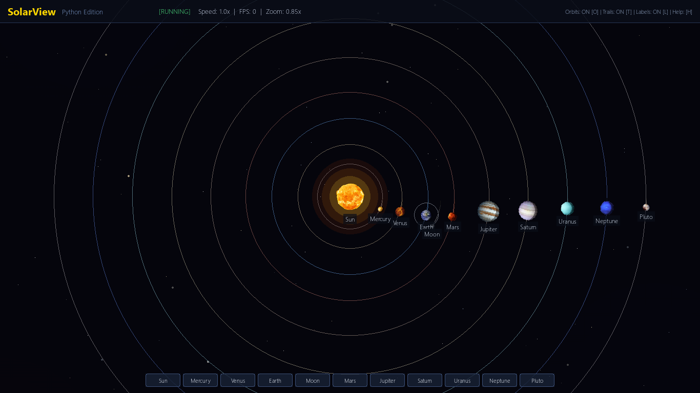
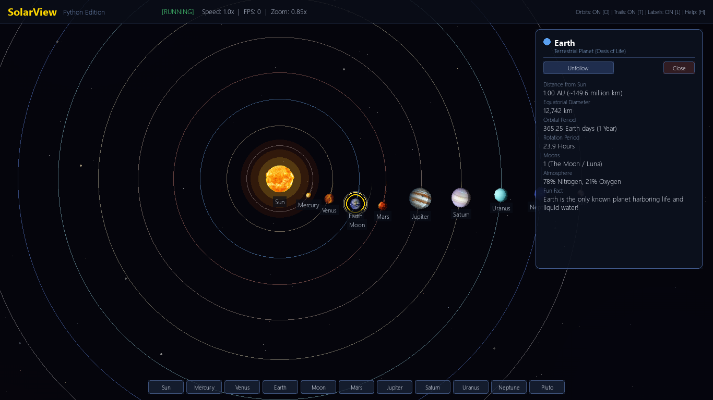

# SolarView 🌌🪐 - Interactive Solar System in Python

[](https://www.python.org/downloads/)
[](https://www.pygame.org/)
[](https://durgesh0314.github.io/solar-system/)
[](LICENSE)

An interactive, visually captivating simulation of our solar system available as a **Native Python Desktop App (Pygame)** and deployed live on the web at **[https://durgesh0314.github.io/solar-system/](https://durgesh0314.github.io/solar-system/)**.

This project is a native Python re-implementation and enhancement of the web-based project [CogniSolver/solar-system](https://github.com/CogniSolver/solar-system). It brings the celestial dance of planets to the desktop with rich physics, smooth camera zoom and panning, planetary day/night terminator shading, real-time facts, and high-resolution textures.

---

## 🌐 Live Web Demo

Visit the deployed web version directly in any web browser:
👉 **[https://durgesh0314.github.io/solar-system/](https://durgesh0314.github.io/solar-system/)**

---

## 🌟 Visual Preview



*The complete Solar System simulation with Sun corona, orbital paths, dynamic starfield, and quick-navigation toolbar.*



*Inspecting Earth and Moon with real-time orbital facts and camera tracking.*

---

## ✨ Key Features

- **High-Resolution Celestial Textures:** Includes all authentic textures for the Sun, Mercury, Venus, Earth, Moon, Mars, Jupiter, Saturn, Uranus, Neptune, and Pluto.
- **Orbital Dynamics & Self-Rotation:** Every celestial body revolves around its parent body and spins on its own axis with accurate relative speeds.
- **Earth & Moon System:** Accurate child-orbit simulation where the Moon faithfully orbits Earth as Earth orbits the Sun.
- **Smooth 2D Camera Controls:** 
  - Smooth pan by dragging with the mouse.
  - Zoom in and out toward the cursor using the mouse wheel (from 0.15x deep-space view to 4.5x close-up inspection).
  - Target tracking: lock and follow any planet across its orbit.
- **Interactive Planetary HUD & Info Cards:** Click or select any celestial body to open a glassmorphism info card displaying real astronomical metrics:
  - Distance from Sun (AU / km)
  - Equatorial Diameter
  - Orbital & Rotational Periods
  - Moons count & atmospheric composition
  - Fascinating astronomical facts
- **Atmospheric Space Environment:**
  - Procedural 900+ star field with multi-layer parallax motion and dynamic twinkling.
  - Faint, ethereal cosmic nebulae clouds rendered across deep space.
  - Pulsating solar corona with multi-layer radial gradient glow.
  - Realistic 3D day/night terminator shading on planets facing away from the Sun.
- **Simulation Time Controls:** Pause, resume, and accelerate simulation speed up to 20x.
- **Customization Toggles:** Turn orbit lines, movement trails, and planet name labels on or off with a single keystroke.

---

## 🎮 Controls & Shortcuts

| Action | Control |
|---|---|
| **Pan Camera** | Click and Drag Left Mouse Button |
| **Zoom In / Out** | Mouse Scroll Wheel |
| **Select / Inspect Body** | Left Click on any Planet or Sun |
| **Follow Camera** | Press `F` or click *Follow Camera* on Info Card |
| **Reset View** | Press `R` (re-centers Sun at default zoom) |
| **Pause / Resume** | Press `Spacebar` |
| **Speed Up Time** | Press `Up Arrow` (up to 20x) |
| **Slow Down Time** | Press `Down Arrow` (down to 0.1x) |
| **Toggle Orbit Lines** | Press `O` |
| **Toggle Movement Trails** | Press `T` |
| **Toggle Planet Labels** | Press `L` |
| **Quick Jump to Sun** | Press `0` |
| **Quick Jump to Planets** | Press `1` (Mercury) through `9` (Neptune), `P` (Pluto) |
| **Toggle Controls Guide** | Press `H` |
| **Deselect / Close Help** | Press `Esc` |

---

## 🚀 Getting Started

### Prerequisites

- Python 3.10 or newer
- `pip` package manager

### Installation

1. **Clone the repository:**
   ```bash
   git clone https://github.com/durgesh0314/solar-system.git
   cd solar-system
   ```

2. **Create and activate a virtual environment (recommended):**
   ```bash
   python -m venv venv
   # On Windows:
   .\venv\Scripts\activate
   # On macOS/Linux:
   source venv/bin/activate
   ```

3. **Install dependencies:**
   ```bash
   pip install -r requirements.txt
   ```

4. **Launch the simulation:**
   ```bash
   python main.py
   ```

---

## 📁 Project Architecture

```
solar-system/
├── assets/
│   └── images/               # High-res celestial textures (.png)
│       ├── earth.png
│       ├── jupiter.png
│       ├── mars.png
│       ├── mercury.png
│       ├── moon.png
│       ├── neptune.png
│       ├── pluto.png
│       ├── saturn.png
│       ├── sun.png
│       ├── uranus.png
│       └── venus.png
├── camera.py                 # Pan, zoom, and target-following camera system
├── celestial_body.py         # CelestialBody physics, rotation, shading, & trails
├── constants.py              # Astronomical metrics, colors, and configuration
├── main.py                   # Main game loop, event dispatcher, and entry point
├── starfield.py              # Procedural parallax starfield & deep-space nebulae
├── ui.py                     # HUD overlay, info cards, and navigation ribbon
├── requirements.txt          # Python dependencies
├── .gitignore                # Git ignore configuration
├── LICENSE                   # MIT License
└── README.md                 # Project documentation
```

---

## 🤝 Attribution & Credits

- Inspired by the open-source web project **[CogniSolver/solar-system](https://github.com/CogniSolver/solar-system)** by [Bijay Pandey](https://github.com/CogniSolver).
- Python implementation developed by **[Durgesh Patil](https://github.com/durgesh0314)**.
- Astronomical data referenced from NASA Planetary Fact Sheets.

---

## 📄 License

This project is licensed under the [MIT License](LICENSE).

